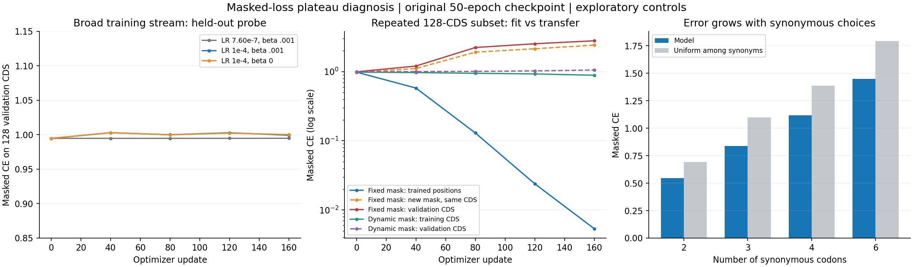

# 完整数据集 masked loss 平台诊断

2026-10-19。材料类型：探索性训练诊断；状态：五组对照执行完成、结果已分析、原权重校验未变。本文使用实际运行结果，不以单样本回放推断全数据集性能。

## 结论

**目前证据将问题定位到“被遮挡位置的原始同义密码子预测”这一泛化瓶颈，没有发现反向传播、AdamW 更新或 masked CE 计算链路故障。** 模型能够记住反复出现的目标，但这种下降不能直接迁移到新掩码、新 CDS。恢复学习率、暂时去掉 KL、降低遮挡率的短程对照均未消除平台。

需要修正上一轮诊断的侧重点：延长到 50 轮时沿用过小的尾部学习率，确实限制了续训更新幅度；但它不足以解释完整数据集约 0.9–1.0 的平台。恢复 1e-4 后，全数据流抽样对照仍然没有改善固定验证探针。

**这些结果不证明 0.9 是理论下限，也不证明当前架构已经最优。** 仍可能存在更好的表示、数据构成、训练目标或长期优化方案。

## 指标口径

Masked CE 使用自然对数，只在选中的可变同义密码子位置计算，按目标 token 数加权。诊断中通过断言核对手工计算的负对数概率与训练代码 `vae_loss` 的 masked CE 一致。探针使用 eval 模式、z=μ，固定输入和目标，避免把动态掩码噪声误当成趋势。

| 数据口径 | 原始第 50 轮权重 masked CE |
|---|---:|
| 历史完整训练集，该轮动态训练统计 | 0.977760 |
| 历史完整验证集，3,949 条 | 0.976372 |
| 本次全长度范围的 256 条训练抽样，17,292 个目标位置 | 0.973804 |
| 本次全长度范围的 256 条验证抽样，17,501 个目标位置 | 0.957077 |
| 本次短序列 128 条固定验证探针，5,437 个目标位置 | 0.994747 |

这些值来自不同样本、掩码和运行模式，不能混为同一条学习曲线。批次间 CDS、同义家族组成和掩码位置不同，会使单步 loss 跳动；固定探针也没有改善，才是平台确实存在的证据。

## 1. 模型能拟合，但小样本下降不能迁移

从冻结训练集选择 128 条长度 192–384 codons 的 CDS，每组从同一个第 50 轮 checkpoint 及 AdamW 状态重新开始。batch=4、累积 8 次、LR=1e-4、β=0.001，共 160 次参数更新，相当于这 128 条数据重复 40 遍。固定掩码组仍保留训练中的 dropout 与 z 采样；固定的是输入掩码。

| 训练方式 | 评估对象 | 更新前 CE | 更新后 CE |
|---|---|---:|---:|
| 固定掩码训练 | 同一批 CDS、训练中见过的掩码 A | 0.984586 | **0.005363** |
| 固定掩码训练 | 同一批 CDS、另一组掩码 B | 0.973997 | **2.421474** |
| 固定掩码训练 | 128 条独立验证 CDS | 0.994747 | **2.796195** |
| 动态掩码训练 | 同一批训练 CDS、探针 A | 0.984586 | 0.887979 |
| 动态掩码训练 | 同一批训练 CDS、探针 B | 0.973997 | 0.876405 |
| 动态掩码训练 | 128 条独立验证 CDS | 0.994747 | 1.056001 |

固定掩码组训练目标准确率达到 99.90%，但掩码 B 的准确率仍约 56.37%，其 CE 却明显增大，说明对错误预测变得更自信。这里观察到的是对特定目标的过拟合，不能将该诊断权重用于替换正式模型。

因此，上一轮“单条 CDS 能训练到近零”只证明学习链路可用，不能证明跨序列 masked loss 应该接近零。动态掩码小样本组同样出现训练改善、验证变差，说明仅靠增加同一小样本的训练次数不足以解决问题。

## 2. 恢复 LR 或去掉 KL，短期内没有解除平台

另三组使用真实训练 loader 的同一批次顺序，从完整训练集取 1,280 个 micro-batch，共 5,120 条 CDS 暴露，每组执行 160 次更新。它是覆盖广泛序列的短程对照，**不是完整一轮，更不是重新训练 50 轮**。

| 对照 | 固定学习率 | β | 同一 128 条验证探针：初始 → 最终 CE |
|---|---:|---:|---:|
| 保留原尾部 LR | 7.596e-7 | 0.001 | 0.994747 → 0.994846 |
| 恢复 LR | 1e-4 | 0.001 | 0.994747 → 0.999281 |
| 恢复 LR，同时去掉 KL | 1e-4 | 0 | 0.994747 → 1.000257 |

三组从相同参数与优化器矩出发，使用相同训练数据与随机种子安排。每组均检验 embedding、encoder、μ、logvar、latent projection、decoder、output 的实际参数变化；均发生更新。结合上一轮重建目标单独向 encoder 回传的梯度检查，没有发现“只有 KL 在更新 encoder”的问题。

这不支持“仅恢复 1e-4 或取消 KL 就能迅速突破平台”的解释；不能据此断言其他调度或更长期训练无效。

## 3. 15% 遮挡与采样噪声不是当前主要解释

在同一批 128 条验证 CDS 上固定 1,909 个目标位置，再改变额外上下文的遮挡率。目标位置完全相同，避免比较不同目标难度。

| 输入 / 模式 | 相同目标位置 CE |
|---|---:|
| 目标可见，eval、z=μ | 0.001203 |
| 5% 输入遮挡，eval、z=μ | 0.976246 |
| 15% 输入遮挡，eval、z=μ | 0.977892 |
| 30% 输入遮挡，eval、z=μ | 0.984553 |
| 15% 遮挡，eval、采样 z，3 次均值 | 0.978063 |
| 15% 遮挡，训练模式 dropout + z，3 次均值 | 0.981124 |

最大的差别来自目标本身由可见变为不可见。15% 降至 5% 只改善约 0.00165；当前 checkpoint 上 z 采样与 dropout 的差异也很小。这是评估时干预，不能等价为“从头改变 mask 配置训练也一定没有影响”。

Clean loss 很低主要表明模型能重建可见输入，不能作为填补未知同义密码子的同等难度指标。

## 4. 原始同义密码子选择确实存在不确定性

同一个氨基酸可以对应多个同义密码子。模型知道蛋白质序列，也不能仅凭它唯一确定原 CDS 在某位置使用哪一个密码子。训练目标要求复原原始选择，而不是输出任意一个编码正确的同义密码子。

256 条验证 CDS 的比较如下；所有方法使用相同目标位置，基线统计仅使用训练集或当前输入可见位置。

| 方法 | Masked CE | 准确率 |
|---|---:|---:|
| 训练集全局同义密码子频率 | 1.131758 | 44.08% |
| 当前序列可见密码子的频率，训练集先验平滑 | 1.072446 | 49.96% |
| 相邻密码子及目标氨基酸条件频率 | 1.067684 | 49.81% |
| 当前 VMAE | **0.957077** | **56.78%** |

模型已经学习到超出这些简单频率基线的信息。它也并未在所有位置同样困难：

| 同义候选数 | 验证目标位置数 | 模型 CE | 准确率 |
|---|---:|---:|---:|
| 2 | 6,931 | 0.545320 | 72.10% |
| 3 | 852 | 0.838430 | 60.56% |
| 4 | 5,495 | 1.116465 | 49.04% |
| 6 | 4,223 | 1.449413 | 40.94% |

误差主要集中在候选更多的同义家族。理论上期望交叉熵可分为真实条件熵与模型分布误差两部分；本实验没有估计出真实条件熵，所以无法把观测到的 0.9 全部解释为不可约误差。

全训练集还有一个直接例子：35,710 条 CDS 对应 35,631 个不同蛋白质，其中找到 37 对仅相差一个同义密码子的 CDS。遮住该位置后，模型输入与蛋白质条件完全相同，目标却不同，说明确有无法唯一辨别的情况。**这些例子数量很少，不足以解释整个数据集的平台。** 它们是不同合法 CDS，不应直接当作去重失败或标注错误。

作为任务背景，同义约束掩码模型 SynCodonLM 的原文报告 MLM 准确率接近 59%。这说明此类任务并不天然应达到 100%；但其数据规模、模型和评估口径与本项目不同，不能拿该数字认定当前模型已复现论文或达到相同水平。[原文：Advancing codon language modeling with synonymous codon constrained masking](https://academic.oup.com/nar/article/54/5/gkag166/8496864)。

## 当前处理建议与边界

保留原 50 轮权重。不要用固定小样本训练得到的近零 loss 作为改进依据，也不要把再次延长轮数当作已验证有效的解决方案。下一项模型改动应在固定验证掩码上验证改善，同时与同义频率基线比较；干净输入重建和 masked 重建需要分别报告。若后续目标是最优 mRNA，masked CE 只是表示预训练指标，最终仍需独立的表达量与序列约束评价，不能由它直接判定最优 mRNA。

本次数据检查确认训练使用 35,710 / 3,949 / 4,342 的固定 train/val/test 划分。训练集中 22,283 条来源字段同时包含 GENCODE v28 与 RiboDecode，13,427 条仅含 GENCODE；当前运行数据不是百万条 GEMORNA 语料。加载校验通过，未发现本次运行的 tokenizer 或划分不匹配；未重新认证所有生物学标注或近同源隔离。

本轮所有实验完成，未开启新的正式全量训练。原始 best/last 与只读备份的 SHA256 在诊断后再次匹配；第 50 轮权重 SHA256 为 `8009efdc3fc3ee61c82925b02feba600be3d6409f923838a612c26eb4af3d673`。

## 复核材料

- [结构化汇总](mask_plateau_summary_20261019.json)：五组完整探针、参数变化、基线及家族统计。
- [遮挡率与噪声对照](mask_plateau_maskratio_20261019.json)。
- [全训练集同义歧义检查](mask_plateau_data_ambiguity_20261019.json)。
- [完整诊断记录包](evidence_20261019/mask_plateau)：逐步日志、样本 ID、运行脚本、完成与源权重校验记录；不包含较大的诊断权重。
- [诊断程序](../latent_decoder/diagnose_mask_plateau.py) 与 [小型验证测试](../latent_decoder/test_mask_plateau.py)，测试在本地与服务器通过。
- [上一轮单样本回放](VGPU_single_record_replay_2026-10-19.md)，用于核验梯度与更新链路。
- 服务器项目：`/root/autodl-tmp/ds_ribodecode_lr_0001_5ep_2026-10-18`；本次日志：`mask_plateau_20261019.log`；结果：`runs/mask_plateau_20261019/`。

局限：单组随机种子、160 次更新、短序列固定探针，不能替代完整多种子训练。全部五组均报告，额外遮挡率检查属于探索性后续实验；未作显著性检验或声称唯一因果解释。未使用独立测试集作模型选择，未验证更大语料、不同架构或 mRNA 实验表达量。
