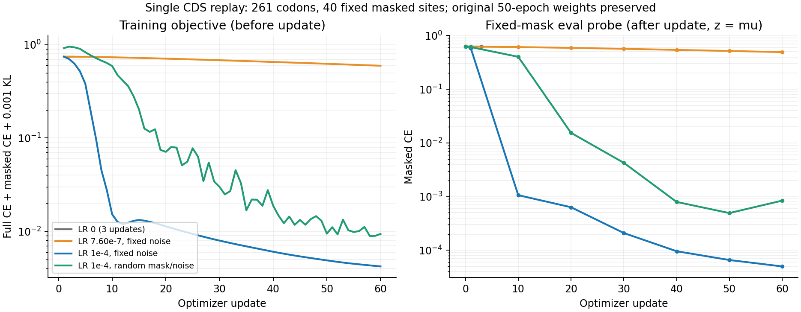

# 50 轮权重保存与单样本训练回放

2026-10-19 北京时间 11:37–11:40 在原服务器完成独立诊断。结论：没有发现前向、损失、反向传播或 AdamW 参数更新链路断开；同一模型在单样本上可迅速拟合。可确认的续训策略局限是：上次延长沿用了第 19 轮已很小的学习率，然后继续衰减，不能把增加 31 轮理解为按 1e-4 获得了 31 轮新的学习强度。尚不能将全量验证集平台的全部原因归结于学习率。

## 保存原权重

服务器项目：`/root/autodl-tmp/ds_ribodecode_lr_0001_5ep_2026-10-18`。

只读备份：`saved_weights/vmae_50ep_20261019_before_replay/`，包含最佳权重（第 37 轮）、最终权重（第 50 轮）、配置、每步/每轮指标、原代码和训练日志。每个文件的 SHA256 与来源一致，并设置只读权限。回放完成后再次校验，原 run 和备份的全部文件均未改变。

本地已下载并核对 SHA256：

- 最佳权重，第 37 轮（本地/服务器文件：`../deliverables/vmae_50ep_best_epoch37_20261019.pt`，未上传 Git），459,838,850 bytes。
- 最终权重，第 50 轮（本地/服务器文件：`../deliverables/vmae_50ep_last_epoch50_20261019.pt`，未上传 Git），459,838,914 bytes。
- [保存清单与 SHA256](../deliverables/vmae_50ep_preserved_manifest_20261019.json)。

## 回放设计

从已冻结训练集确定性选取 1 条 261 codons 的 CDS，固定遮挡 40 个可变位置；未使用验证集或测试集。将这条记录复制为 batch=4，保留 gradient accumulation=8、FP32、原 AdamW 一阶/二阶矩、权重衰减、梯度裁剪、β=0.001 和 Full CE + Masked CE + KL 损失。每组都重新载入同一份第 50 轮 checkpoint，组间不继承回放权重。

固定组每步复用相同输入、掩码，以及相同的 dropout/z 随机数；随机组保留动态掩码、dropout 和 z 采样。学习率在诊断副本中单独设置为常数，不使用 scheduler。每步记录裁剪前梯度范数、真实参数差、改变的参数元素数量；固定探针使用 eval 模式、z=μ 和同一掩码，使不同组可以比较。

零 LR 对照执行 3 次更新，其余各 60 次更新。这里的 loss 来自同一条样本，不是全量验证指标。

| 回放组 | 固定探针 masked CE：初始 → 最终 | 最终 masked accuracy | 参数变化 |
|---|---:|---:|---|
| LR=0，3 次更新 | 0.624817 → 0.624817 | 77.5% | 0 个元素改变 |
| LR=7.596e-7，60 次 | 0.624817 → 0.492996 | 85.0% | 38,299,041 个元素改变 |
| LR=1e-4，固定随机数，60 次 | 0.624817 → 0.000050003 | 100% | 38,301,724 个元素改变 |
| LR=1e-4，动态 mask/随机数，60 次 | 0.624817 → 0.000841820 | 100% | 38,301,733 个元素改变 |

训练总 loss：固定 1e-4 组 0.744720 → 0.004211；动态组 0.919131 → 0.009390。动态组相邻 59 次比较中仍有 20 次 loss 上升，但整体已显著下降，说明“单步反复跳动”不等于“没有学习”。固定 1e-4 组也有 3 次上升，AdamW 优化不保证每步单调。

## 逐环节定位

1. **重建目标能传回 Encoder**。单独设 β=0 后，重建梯度范数为 Encoder=0.420402、μ=0.679015、logvar=0.092907、Decoder=0.501469。没有缺失梯度的参数张量，排除了“只有 KL 在更新 Encoder”的解释。
2. **梯度裁剪没有截断学习**。初始梯度范数 2.033802，按原阈值 1.0 缩放后仍产生参数更新。
3. **AdamW 的 step 计数不能代替参数变化证据**。LR=0 时计数从 55800 增至 55803，梯度非零，但权重完全不变；LR>0 时各模块均有实际变化，计数增至 55860。
4. **学习率决定实际更新幅度**。同一参数与梯度起点，7.596e-7 组第一次更新的全参数 ΔL2=0.00119419；1e-4 组为 0.15720743，相差约 132 倍。提高诊断 LR 后，固定和动态 mask 都能拟合该样本，没有发现模型无法学习的实现故障。
5. **上次延长的策略过于保守**。第 19 轮已经处于 20 轮 cosine 调度尾端；延长时从 7.596e-7 继续降到零，峰值只相当于原 1e-4 的约 0.76%。这解释了为何“延长很多轮”仍可能只产生很小的收益，应把续训 LR 作为单独决策。第 50 轮保存 LR=0 本身是正常的调度终点，不能据此声称前 50 轮都未更新。

上述证据确认了学习链路可用和续训 LR 的限制；未证明低 LR 是全量验证平台的唯一成因。单样本可记忆不代表模型在多样本或独立数据上获得相同下降。若继续排查全量平台，应在独立副本上对固定小子集进行 LR 对照，并保持验证指标口径一致，而非把单样本诊断权重用于正式模型选择。

## 文件与验证

- [完整回放记录包](evidence_20261019/single_record_replay)：固定数据/掩码、逐步参数差、四组日志、汇总和脚本；不包含较大的诊断权重。
- [结构化汇总](single_record_replay_20261019_summary.json)、[SVG 曲线](single_record_replay_20261019.svg)。
- 回放入口：`latent_decoder/replay_single.py`；隔离性与零/非零 LR 测试：`latent_decoder/test_replay_single.py`，本地及服务器均通过。
- 服务器诊断日志：`single_record_replay_20261019.log`，结果：`runs/single_record_replay_20261019/`。各组另存 `*.model.pt`，标记 `diagnostic_only`，不可当作完整训练 checkpoint 恢复。

所有回放进程已退出，未启动新的全量训练。未进行独立泛化或 mRNA 表达量验证。
