# GNN邻居聚合与Transformer全局修正

## Material Passport

- Origin Skill: academic-research-suite/experiment-agent；实现遵循ponytail。
- Date: 2026-10-31；Verification Status: PLANNED（须等待实际训练及复算）。
- Runtime: gpt-6.1-sol；无子代理参与。
- 用户授权：在223.109.239.36:14020训练及实验；凭证只用于交互登录，不保存。

## 问题与架构

比较局部邻居聚合后做全局注意力，及加入对齐的sTASEP物理embedding后做全局修正，是否改善公开小鼠Ribo-seq逐密码子位置预测。

```mermaid
flowchart LR
  E[密码子embedding] --> I[残差输入融合]
  S[结构及序列邻接边] --> G[两层GNN聚合]
  E --> G
  P[sTASEP四次模拟的均值及标准差] --> PE[物理embedding]
  G --> I
  PE --> I
  I --> T[位置编码及Transformer全局注意力]
  T --> F[主融合预测头]
  G --> F
  PE --> F
```

z = E + sigmoid(a) × LayerNorm(GELU(Linear([E,P,G])))；a初始使sigmoid(a)=0.1。加入一次正弦位置编码后通过一层8头pre-LN Transformer，width424、FF424。主头仍融合P、G和Transformer输出，保留原三路辅助监督头。因此早期物理消融衡量的是已有末端物理路径时的额外早期交互收益，不能等同物理总贡献。残差门值亦不是可识别的生物重要性。

八组参数及初始化逐张量一致：parallel（输入投影只读E）、physics_polish（E+P）、gnn_polish（E+G）、physics_gnn_polish（E+P+G）、shuffled_physics（只将早期物理位置置乱，末端真实物理保持）、self_graph（GNN仅自身变换，无两类邻居）、sequence_edges（仅去结构配对边）、diagonal_attention（仅自身注意力、仍有FFN及残差）。前四组为候选，其余为解释性对照。零槽输入仍保留同形状矩阵，名义参数一致不代表各组有效容量完全相同。

物理置乱为固定的长度相关随机排列，逐样本仅作用有效位置，训练及测试规则相同。不是因果随机化。图节点为密码子，序列边双向相邻；结构配对边沿用既有核苷酸至密码子对齐。sTASEP是不可微外部数值模拟，使用之前400条训练记录拟合的停留代理参数，不作真实速率恢复的断言。

## 数据与口径

固定400训练、80验证；另选120主测试，排除过去1500条记录中的基因、CDS及完全相同蛋白。上一轮新120仅作补充测试。总720输入。未做近同源聚类；同一GSE73553小鼠肝脏、80–250密码子的筛选面板，不是跨研究或TE/总表达/蛋白产量验证。

源LIVER.csv SHA256：70a6621d0779a0cef17ce49427560c0c3c1b3b237e005a1d1038f047aff8aa7f。结构及模拟沿用既有数值代码、相同逐基因种子和训练拟合参数。没有序列生成或序列优化步骤。

主指标是每条转录本内部有效位置的预测与log1p标签Pearson，再按转录本等权平均。每种子预测先单位总量归一化，再三个种子等权集成；集成Pearson与种子Pearson均值分列。另报去首尾5密码子的内部位置指标及三个辅助头。图示误差条使用2000次基因bootstrap；配对差为同一基因的差再bootstrap，探索性未作多重比较校正。

## 训练与锁定

8组×30101/30102/30103，共24份新权重。原生sum-normalized PCC+sqrt-L1主损失，三个辅助损失平均乘0.1。AdamW lr3e-4、2轮warmup、余下28轮cosine至3e-5，wd.01、clip1、batch8，最多30轮、验证主native损失patience7。权重按主native验证损失挑选，候选按三个种子验证Pearson均值、限前四组，在计算任何新测试前锁定。

旧BiLSTM、旧Transformer、旧context_x2各3份作为参考；它们的训练配方与参数量不同，不用于将全部差值归因架构。主要架构比较以本轮parallel和匹配消融为准。

CPU检查→新数据准备→实际CUDA batch8检查→源码与输入哈希锁定→全部训练→验证候选和权重锁定→留出评估→代表模型重载与独立Pearson公式复算→报告及本地归档核验。每子进程超时3600秒；失败保留原始日志、停队列并诊断，不静默跳组。GPU分配限制12%，TF32关闭，使用前轮独立venv，不修改系统或其他项目。

架构参考：[GraphGPS原论文](https://arxiv.org/abs/2205.12454)提出结合位置/结构编码、局部消息传递及全局注意力；本实现是对此思路的有限实验，不是复现作者完整模型或论文SOTA。
